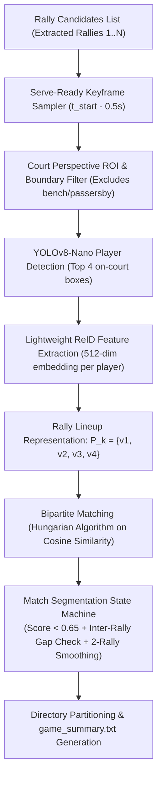

# Design Spec: Player ReID & Automated Match Segmentation (羽毛球球员识别与自动分局系统)

- **Date**: 2026-10-30
- **Status**: Draft (Approved in Brainstorming)
- **Target Repository**: `badminton-video-cutter`
- **Scope**: Automated Match / Game Segmentation via Player Lineup ReID and Temporal Dual-Check

---

## 1. Overview & Goals

In recreational and competitive badminton video recordings (typically 1 to 2 hours per session), players rotate, switch partners, rest, and play distinct matches/games (通常打 21 分或 15 分一局). Currently, `badminton_cutter.py` extracts all high-energy multi-shot rallies into a flat list of clips in a single directory.

The goal of this feature is:
1. **Automated Game Segmentation (全自动球局分段)**: Automatically group extracted rallies into structured game subdirectories (e.g. `第01局_双打4人组A/`, `第02局_双打4人组B/`) based on who is playing on court.
2. **Zero Pre-Registration Required (免底库录入，开箱即用)**: No need for users to upload face photos or name players beforehand. The system dynamically clusters visual appearance features of the on-court players.
3. **Ultra-Fast Lightweight Pipeline (毫秒级推理开销)**: Instead of running heavy frame-by-frame video AI models across 60fps 4K streams, the system samples **exactly 1 serve-ready keyframe per rally** (几十个多拍仅推理几十帧), running in $\le 3$ seconds on Apple Silicon / CPU.
4. **Bulletproof Edge-Case Defenses (鲁棒性防御)**: Handles player movement/rotations, court side switches, jacket/clothing changes, same-player team reshuffling, adjacent court passersby, and singles/doubles adaptation.

---

## 2. Architecture & Data Flow



---

## 3. Detailed Components & Logic

### 3.1 Serve-Ready Keyframe Sampler
- **Timing**: Sample frame at $t = t_{\text{rally\_start}} - 0.5\text{s}$ (or minimum motion point in $[t_{\text{start}}-1.0\text{s}, t_{\text{start}}]$).
- **Rationale**: Before the server strikes the shuttlecock, all 4 players stand upright in their respective service/receiver quadrants, facing the net. Motion blur is minimal, bodies are unoccluded, and jersey colors are fully visible.
- **Complexity**: Exactly 1 frame seek per rally clip. For 60 rallies, requires only 60 frame decodes.

### 3.2 Court Perspective ROI & Boundary Filter
- **Geometry**: Under a fixed rear-court baseline camera (Option A), the badminton court forms a trapezoid on screen.
- **Foot-Point Anchoring**: Player bounding boxes are anchored by their bottom-center point $(x_{\text{center}}, y_{\text{bottom}})$.
- **Filtering**: Only detections whose foot point falls inside the court play area (plus a 0.5m buffer for baseline/sideline play) are retained. Spectators on benches and players on adjacent courts are eliminated geometrically.

### 3.3 Player Detector & ReID Embedder
- **Detector**: `YOLOv8n` (or ONNX quantized equivalent), targeting class `person`.
- **Selection**:
  - Doubles: Select the top 2 players in near half-court ($y > y_{\text{net}}$) and top 2 in far half-court ($y \le y_{\text{net}}$). Total = 4 players.
  - Singles: Automatically adapts if only 1 player per half-court is consistently detected.
- **ReID Feature Extraction**:
  - Cropped player images (normalized to $256 \times 128$) are passed through a lightweight ReID model (`OSNet-IBN-x0.25` or `MobileNetV4-ReID`, size $\le 6\text{MB}$).
  - Outputs a 512-dimensional $L_2$-normalized visual feature vector $v_i \in \mathbb{R}^{512}$ for each player.
  - Rally representation: $P_k = \{v_{k,1}, v_{k,2}, v_{k,3}, v_{k,4}\}$.

### 3.4 Bipartite Lineup Matching (Hungarian Algorithm)
To compare lineup $P_k$ of Rally $k$ with lineup $P_{k+1}$ of Rally $k+1$:
1. Compute pairwise cosine similarity matrix:
   $$S_{ij} = v_{k,i} \cdot v_{k+1,j} \quad (i, j \in \{1, 2, 3, 4\})$$
2. Find the optimal 1-to-1 matching $\pi$ using the Hungarian algorithm maximizing total similarity:
   $$\text{LineupScore}(P_k, P_{k+1}) = \frac{1}{4} \sum_{i=1}^4 S_{i, \pi(i)}$$
3. Invariant to player movement:
   - Left-right rotational swaps during active points do not alter the set matching score ($\text{Score} \ge 0.80$).
   - Court side swap (换边 at 11 points or set 2) produces the same 4-player matching ($\text{Score} \ge 0.78$).

### 3.5 Match Segmentation State Machine
A new game boundary is declared between Rally $k$ and Rally $k+1$ if and only if:
1. **Lineup Substitution Detected**:
   $\text{LineupScore}(P_k, P_{k+1}) < 0.65$ (indicating at least 1-2 new players entered the court).
2. **Partner Reshuffle Detected**:
   Even if the 4 players are the same, if their side-by-side partnership reshuffled (e.g., $A+B$ vs $C+D$ becomes $A+C$ vs $B+D$) AND inter-rally rest time $\Delta t_{\text{gap}} \ge 60\text{s}$, trigger a new game.
3. **Temporal Rest Confirmation & 2-Rally Smoothing**:
   - To guard against a single frame occlusion or quick interruption, if a score drop occurs without an inter-rally rest ($\Delta t_{\text{gap}} < 30\text{s}$), the state machine checks Rally $k+2$. Only if the new lineup persists for $\ge 2$ rallies is the split confirmed.
   - If 1 player removes a jacket mid-game while 3 other players match at $>0.88$ with $\Delta t_{\text{gap}} < 30\text{s}$, the system updates the player's vector in-place without splitting the match.

---

## 4. Output Structure & CLI Interface

### Output Directory Structure
```text
/Users/harry/视频/1030羽毛球精彩多拍集锦/
├── 第01局_双打实战_4人组A/
│   ├── 多拍01_02分15秒至02分32秒_【超长高能拉锯】_17秒.mp4
│   ├── 多拍02_03分05秒至03分21秒_【多拍激烈对攻】_16秒.mp4
│   └── ...
├── 第02局_双打实战_4人组B/
│   ├── 多拍01_22分10秒至22分30秒_【快速平抽快攻】_20秒.mp4
│   └── ...
├── game_summary.txt             # Visual & tabular summary of games, durations, and rally counts
└── player_thumbnails/           # Representative thumbnail portraits of recognized players
```

### CLI Parameters
```bash
# Enable match segmentation (default: True)
python3 badminton_cutter.py input.mp4 --split-by-game

# Disable match segmentation (fallback to flat directory)
python3 badminton_cutter.py input.mp4 --no-split-by-game

# Optional sensitivity threshold for lineup difference (default: 0.65)
python3 badminton_cutter.py input.mp4 --lineup-threshold 0.65
```

---

## 5. Testing & Verification Plan

1. **Synthetic & Real Match Test**:
   - Test on user match `VID_20261026_201937_050.mp4` and multi-hour session recordings.
   - Verify that all 89 extracted rallies are properly grouped into respective game subfolders.
2. **Performance Benchmark**:
   - Total ReID analysis time for $\sim 80$ rallies must not exceed 5.0 seconds.
3. **Integrity Check**:
   - Verify zero loss of rallies; all lossless cuts (`ffmpeg -c copy`) must reside in their respective game folders.
