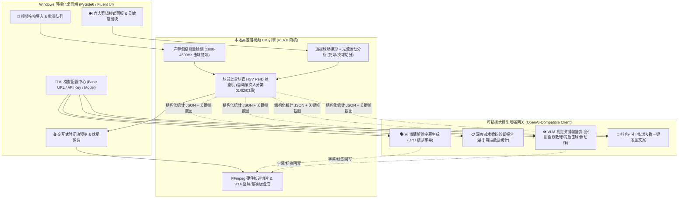

# 羽毛球 AI 剪辑大师 —— Windows 可视化桌面版与可配置大模型（LLM/VLM）架构规划书

- **文档版本**：v2.0 Roadmap Draft (规划归档版 · 暂不上线)
- **基线引擎版本**：`badminton-video-cutter v1.6.0`
- **状态**：已规划封存（日常视频处理仍沿用现有 `v1.6.0` 自动化流水线）

---

## 1. 核心定位与设计原则

### 1.1 为什么要采用「本地 CV 算子 + 可配置 AI 大模型」双引擎架构？
羽毛球实战录像通常单场长达 30～60 分钟（1080p/4K 60fps，约 10 万～20 万帧）。
- 如果将整段视频直接发送给云端大模型，会导致**数百万 Token 消耗、数十分钟上传等待，以及时间轴毫秒级起止点漂移**。
- 因此，最佳工程实践是**「大小模型协同（Hybrid AI Architecture）」**：
  1. **底层毫秒级剪辑（本地算法引擎，0 成本、极速、离线可用）**：
     复用现有 [`badminton_cutter.py`](../../scripts/badminton_cutter.py)、[`match_segmenter.py`](../../scripts/match_segmenter.py) 与 [`modes_handler.py`](../../scripts/modes_handler.py)，负责声学峰值检测、球场透视梯形光流追踪、球员上衣色彩特征重识别（ReID）自动分场次/球局、死球剔除与无损切片。
  2. **认知与表现层（用户自定义 API 大模型，按需开启）**：
     支持用户自由配置任意兼容 OpenAI 接口协议的大模型（DeepSeek、通义千问、Kimi、GPT-4o、Claude、Gemini 或本地 Ollama），负责**赛事解说词生成、AI 教练复盘报告撰写、高光语义精筛（VLM 关键帧鉴赏）、朋友圈/抖音文案生成**。

---

## 2. 系统总体架构设计

---

## 3. Windows 可视化界面（GUI）四大功能模块规划

### 模块一：主工作台（拖拽导入与一键执行）
- **零门槛拖拽区**：支持直接拖入单个 `.mp4/.mov` 视频或整个场馆录制文件夹（如 `1029/`）。
- **剪辑模式勾选卡片**（默认勾选「经典全能合集」）：
  - `[√]` **模式 0：经典全能合集（默认）** —— 自动按换人分球局 + 多拍集锦 + 接发秒杀 + 最佳10大好球
  - `[ ]` **模式 1：一刀不剪·纯享紧凑版** —— 剔除所有捡球走动，30分钟浓缩为8分钟连贯实战
  - `[ ]` **模式 2：抖音/快手 9:16 竖屏短视频** —— 焦点平滑跟随，适合手机全屏观看
  - `[ ]` **模式 3：个人高光 Solo 视角** —— 点选画面中的自己（近端左/右、远端左/右），只剪自己参战的高光回合
  - `[ ]` **模式 4：发接发前三拍战术复盘** —— 专抓发球与接发球前 3.5 秒，定位失分痛点
  - `[ ]` **模式 5：球风分类陈列室** —— 自动归类为「后场重杀突破」「多拍高能拉锯」「网前平抽快攻」
- **直观参数滑块**：
  - `多拍起步门槛`（默认 5 秒，可调 3～15 秒）
  - `换球/捡球切分灵敏度`（默认标准，可向「紧凑」或「宽容」滑动）
  - `换人分球局休息间隔`（默认 22 秒）

### 模块二：可视化时间轴与球局微调器（交互预览）
- **声波+运动能量双轨波形图**：在底部时间轴直观展示整场视频的回合分布，绿色块代表保留的多拍回合，灰色块代表自动剔除的捡球死球时间。
- **拖拽微调与一键合并/拆分**：
  - 如果发现某个球想多留 2 秒欢呼画面，鼠标拖动绿色块右边缘即可。
  - 如果某两局想手动合并或拆分，右键点击时间轴节点即可一键「在此处新建一局」或「合并至上一局」。

### 模块三：AI 大模型自由配置中心（BYOK - Bring Your Own Key）
提供标准的 **OpenAI 兼容接口配置面板**，配置文件加密保存在本地 `config/ai_settings.json`：

| 配置项 | 说明与示例 |
| :--- | :--- |
| **启用 AI 大模型增强** | 开关切换（关闭时 100% 纯本地运行，0 费用） |
| **API 接口地址 (`Base URL`)** | 支持官方及任意中转/本地地址： • DeepSeek: `https://api.deepseek.com/v1` • 硅基流动/OpenRouter: `https://api.siliconflow.cn/v1` • OpenAI: `https://api.openai.com/v1` • 本地 Ollama: `http://localhost:11434/v1` |
| **API 密钥 (`API Key`)** | `sk-xxxxxxxxxxxxxxxxxxxxxxxx`（支持掩码显示与本地保存） |
| **文本模型名称 (`Text Model`)** | 如 `deepseek-chat`、`gpt-4o-mini`、`qwen-plus` |
| **视觉模型名称 (`Vision Model`，可选)** | 如 `gpt-4o`、`qwen-vl-max`、`gemini-2.5-flash`（用于关键帧视觉鉴赏） |
| **测试连接按钮 (`Test Connection`)** | 一键发送 Ping 请求，验证延迟与可用性 |

### 模块四：AI 大模型赋能的四大增值特性
1. **AI 体育解说员字幕（自动生成 `.srt` 并可选压制进视频）**：
   - 将每个回合的时长、拍数、分贝峰值、终结方式喂给大模型，自动生成解说词（支持切换「央视洪钢/龚伟杰专业解说风」「球馆搞笑吐槽风」「热血动漫风」）。
2. **AI 私人羽毛球教练诊断报告**：
   - 将 `review` 模式的统计数据交给大模型，生成图文并茂的 Markdown/PDF 诊断书，指出哪一局体能下滑、发球质量波动原因及下次训练建议。
3. **VLM 视觉关键帧神仙球识别（可选）**：
   - 仅抽取高潮回合的 3～5 张关键帧缩略图发给视觉大模型，精准识别出「鱼跃救球」「滑板吊球」「背后击球」并打上专属炫酷角标。
4. **社媒发圈文案一键复制**：
   - 剪辑完成后自动生成一段带时间戳导航的球友群战报或抖音文案。

---

## 4. Windows 独立打包与交付方案

为了确保在任何 Windows 10 / Windows 11 电脑上**双击即用、无需安装 Python 环境**：

1. **GUI 框架选型**：`PySide6` + `QFluentWidgets`（微软 Fluent Design 毛玻璃现代深色主题，原生支持 Windows 高分屏缩放与硬件视频预览）。
2. **内置便携式工具链**：
   - 在安装包 `bin/` 目录下直接内置静态编译版 `ffmpeg.exe` 与 `ffprobe.exe`（自动启用 NVIDIA `h264_nvenc` / Intel `h264_qsv` 硬件加速编码）。
3. **打包构建工具**：
   - 使用 `PyInstaller` 或 `Nuitka` 将 Python 引擎、NumPy/OpenCV 核心算子及 GUI 打包为独立目录或单文件安装程序（`BadmintonAICutter_Setup_v2.0_Win64.exe`）。

---

## 5. 分阶段实施路线图（待启动时按阶段推进）

| 阶段 | 里程碑名称 | 核心交付内容 | 预计工作量 |
| :--- | :--- | :--- | :--- |
| **Phase 1** | **核心引擎 API 化与 LLM 网关层** | 将现有 `v1.6.0` CLI 封装为支持进度回调（Progress Callback）的后台服务类；新增 `llm_client.py` 实现通用 OpenAI 接口调用与连接测试。 | 1～2 天 |
| **Phase 2** | **Windows 可视化主界面开发** | 完成文件拖拽队列、六大模式勾选面板、参数滑块、AI 接口设置弹窗与实时日志进度条。 | 2～3 天 |
| **Phase 3** | **时间轴预览与 AI 字幕/战报集成** | 增加回合时间轴微调预览器，接入 AI 解说字幕生成与教练复盘报告渲染。 | 2 天 |
| **Phase 4** | **Windows `.exe` 独立打包与硬件加速调优** | 集成 Windows 版 FFmpeg (`nvenc`/`qsv`)，完成一键安装包打包测试。 | 1 天 |
