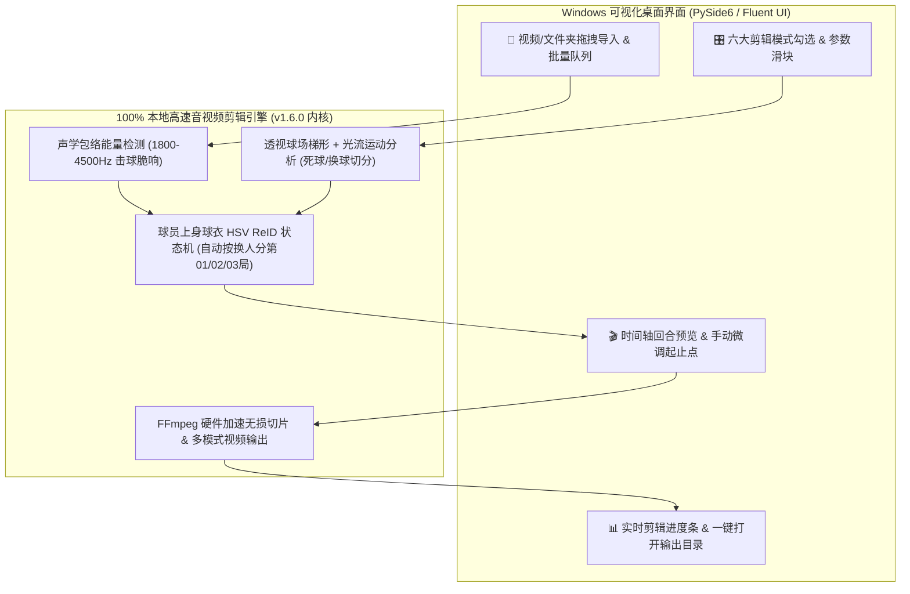

# 羽毛球 AI 剪辑大师 —— Windows 纯净可视化剪辑桌面版规划书

- **文档版本**：v2.0 Roadmap (纯净本地剪辑版 · 暂不上线)
- **基线引擎版本**：`badminton-video-cutter v1.6.0`
- **核心原则**：**100% 纯本地运行、零废话、专注视频剪辑与输出**（砍掉解说字幕、文案生成、外部大模型接口等一切非剪辑功能，开箱双击即用，无需联网、无需配任何 Key）

---

## 1. 软件核心定位

做一个**纯粹、高效、可视化的 Windows 羽毛球视频自动剪辑桌面软件**：
- 直接复用现有成熟的 `v1.6.0` 本地算法内核（[`badminton_cutter.py`](../../scripts/badminton_cutter.py)、[`match_segmenter.py`](../../scripts/match_segmenter.py)、[`modes_handler.py`](../../scripts/modes_handler.py)）。
- **只干一件事**：把球馆录制的原始长视频拖进去，自动识别每一局换人、自动剔除捡球/换球死球时间，按所选模式直接输出剪辑好的高清视频文件。

---

## 2. 系统架构图

---

## 3. Windows 可视化界面（GUI）三大功能模块

### 模块一：视频导入与剪辑模式面板（主界面左侧/右侧）
1. **一键拖拽导入**：
   - 支持直接拖入单个 `.mp4 / .mov` 视频，或直接拖入整个日期文件夹（如 `1029/`），支持多视频排队批量剪辑。
   - 自定义输出文件夹路径（剪完后可一键点击「打开输出文件夹」）。
2. **六大剪辑输出模式勾选**（默认只勾选模式 0，可多选同时输出）：
   - `[√]` **经典全能合集（默认）**：自动按换人分`第01局/第02局/第03局` + `01_精彩多拍集锦` + `02_发球接发秒杀` + `00_全场最佳10大好球`
   - `[ ]` **一刀不剪·纯享紧凑版 (`condensed`)**：剔除所有捡球走动，把 30 分钟比赛无缝拼接成 8～10 分钟纯打球连贯长片
   - `[ ]` **9:16 竖屏短视频 (`vertical`)**：智能焦点平滑居中裁剪，直接生成适合手机全屏观看的竖屏视频
   - `[ ]` **个人高光 Solo 视角 (`solo`)**：选择场地站位（近端左/右、远端左/右），只剪出该站位球员高频参战的回合视频
   - `[ ]` **发接发前三拍切片 (`review`)**：专门截取每个回合开球前 3.5 秒视频切片
   - `[ ]` **球风分类视频库 (`showcase`)**：将回合视频自动分拣输出至 `01_后场重杀突破`、`02_多拍高能拉锯`、`03_网前平抽快攻` 三个视频文件夹
3. **核心剪辑参数滑块（带「恢复默认」按钮）**：
   - `多拍最短保留时长`：默认 `5.0 秒`（滑块范围 3～15 秒）
   - `回合结束/换球切分灵敏度`：默认 `标准`（防止提前截断未落地救球，同时过滤漫长换球）
   - `换人分球局休息间隔`：默认 `22 秒`（每局最少回合数默认 `8 拍`）

### 模块二：可视化时间轴预览与微调（主界面中部）
- **内置视频播放器 + 时间轴色块条**：
  - 扫描完成后，在时间轴上用**绿色色块**标出所有识别到的有效打球回合，**灰色区域**代表将被剔除的捡球/换球死球时间，并用分割线标出自动识别的`第01局 / 第02局 / 第03局`分界点。
- **支持手动微调（可选操作，不调可直接点导出）**：
  - 点击任意绿色回合块即可预览该球视频；
  - 鼠标拖动色块左右边缘，可手动延长或缩短某一球的开头/结尾；
  - 支持勾选/取消勾选某几个回合，或在任意位置右键点击「在此处分割新的一局 / 合并至上一局」。

### 模块三：高速硬件编码输出与进度监控（底部状态栏）
- 显示当前处理阶段（`正在分析声波与光流` -> `正在识别球衣换人分局` -> `正在高速导出视频 12/45`）、剩余预计时间及总耗时。
- 自动检测 Windows 电脑显卡，优先开启 **NVIDIA (`h264_nvenc`) / Intel (`h264_qsv`) / AMD (`h264_amf`)** 硬件加速编码，加上无损流拷贝（Stream Copy），几分钟即可完成整场高清输出。

---

## 4. Windows 独立打包交付方案

- **零环境依赖**：使用 `PySide6` + `PyInstaller` 打包为 Windows 64位独立程序包，内置静态版 `ffmpeg.exe` 与 `ffprobe.exe`。
- **开箱即用**：在 Windows 10 / 11 上无需安装 Python、无需配置环境变量、无需联网，解压后双击 `羽毛球AI剪辑大师.exe` 即可直接拖入视频剪辑输出。

---

## 5. 分阶段开发计划（暂不上线，待需要时启动）

| 阶段 | 核心任务 | 预计耗时 |
| :--- | :--- | :--- |
| **Phase 1：引擎回调封装** | 将现有 `v1.6.0` 脚本封装成可被界面调用的后台线程类（支持进度百分比回调、中途取消、返回回合时间轴列表）。 | 1 天 |
| **Phase 2：可视化主界面开发** | 完成文件拖拽列表、六大剪辑模式勾选区、参数滑块与实时进度条。 | 1.5 天 |
| **Phase 3：时间轴预览与微调器** | 接入内置视频预览窗口与回合起止点拖拽微调、球局分割点调整功能。 | 1.5 天 |
| **Phase 4：Windows `.exe` 打包** | 内置 Windows 版 `ffmpeg.exe` 并完成独立安装包编译与测试。 | 1 天 |
